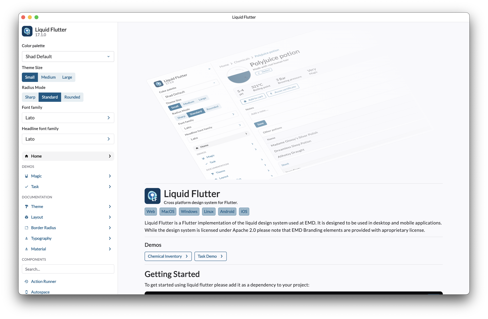

<p align="center">

</p>

## Liquid Flutter

This is a [flutter](https://flutter.dev) implementation of the [liquid design system](https://liquid.emd.design) used at EMD. It is designed to be used in desktop and mobile applications.
While the design system is licensed under [Apache 2.0](./LICENSE) please note that [EMD Branding elements](./packages/liquid_flutter_emd_theme/) are provided with a proprietary license.

Please rely on the [online documentation](https://emdgroup-liquid.github.io/liquid-flutter/)

This library incluse a copy of the Lato font licensed under the [Open Font License](https://fonts.google.com/specimen/Lato/license)

To simply install run

```sh
flutter pub add liquid_flutter
```

## Requirements

Flutter `3.47.0` or newer. Since Flutter 3.47, Material lives in the
[`material_ui`](https://pub.dev/packages/material_ui) package rather than
`package:flutter/material.dart`. `liquid_flutter` renders `material_ui`
widgets and its public API exposes `material_ui` types (for example the
`ThemeData` passed to `LdThemedAppBuilder`), so your app has to use the same
library.

Add the package and import it instead of the SDK Material library. Add
`cupertino_ui` as well if you use Cupertino widgets:

```sh
flutter pub add material_ui
```

```dart
import 'package:material_ui/material_ui.dart';
```

### Migrating an app that still imports `package:flutter/material.dart`

Migrate the app root. Liquid widgets resolve `ThemeData` and
`MaterialLocalizations` from `material_ui`, so they throw
`No MaterialLocalizations found.` when the only `MaterialApp` above them is the
legacy one. Importing both libraries also makes names such as `MaterialApp`,
`Scaffold` and `Theme` ambiguous.

`MaterialUiCompatibilityBridge` is **not** a replacement for that migration.
It maps the modern theme *down* for legacy widgets, so it only helps below a
`material_ui` app - for a dependency that still renders
`package:flutter/material.dart` widgets:

```dart
import 'package:material_ui/material_ui.dart';

MaterialApp(
  // A material_ui app root is still required.
  builder: (context, child) => MaterialUiCompatibilityBridge(child: child!),
  home: const LegacyPackageWidget(),
)
```

The bridge is a deprecated, temporary utility in `material_ui` and will be
removed eventually; prefer migrating the legacy dependency.

### Localizations

Use `liquidLocalizationsDelegates` rather than the generated
`LiquidLocalizations.localizationsDelegates`: the latter still references the
deprecated `flutter_localizations` delegates, which a `material_ui` app cannot
resolve, leaving Material strings untranslated.

```dart
import 'package:liquid_flutter/liquid_flutter.dart';
import 'package:material_ui/material_ui.dart';

MaterialApp(
  localizationsDelegates: liquidLocalizationsDelegates,
  supportedLocales: LiquidLocalizations.supportedLocales,
  // ...
)
```

